# SoccaV2 – Detail-Ebene

Ergänzt [ARCHITEKTUR.md](ARCHITEKTUR.md). Jedes Diagramm geht in einen Bereich hinein: jede Verzweigung, jede Prüfung, jeder Randfall.
Mit **OFFEN** markierte Knoten sind Entscheidungen, die noch nicht getroffen wurden.

---

## D1. Login, Onboarding, Sperren

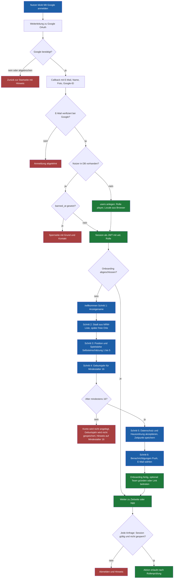

---

## D2. Team: gründen, einladen, verwalten

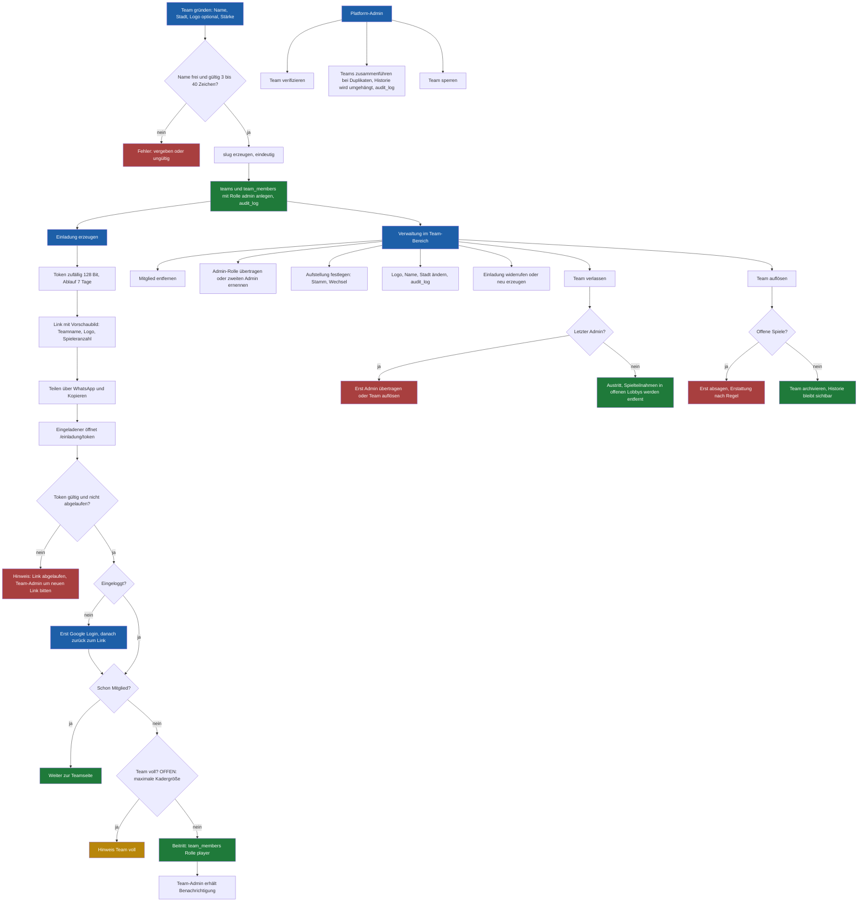

---

## D3. Spielsuche: erstellen, finden, annehmen

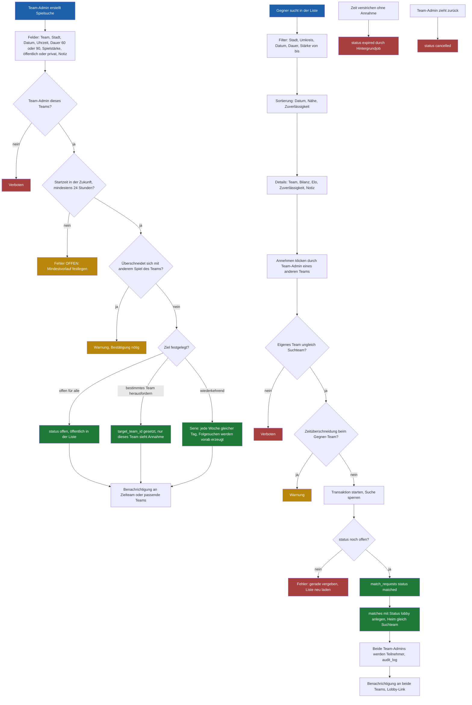

---

## D4. Lobby: Regeln für Teilnehmer, Bereit, Ersatz

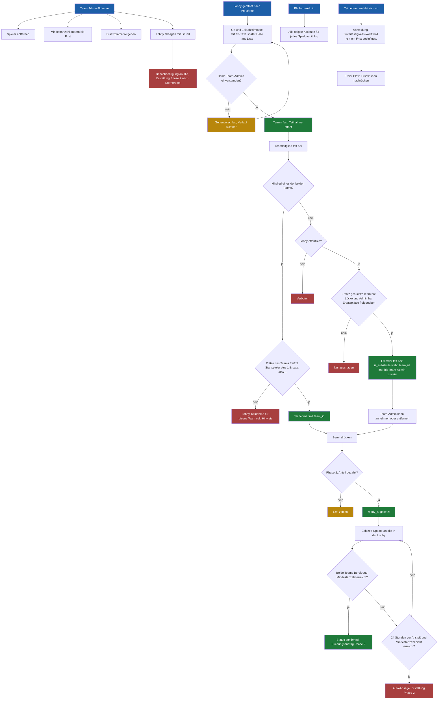

---

## D5. Spieltag: Live-Eingabe, Ergebnis, Auswertung

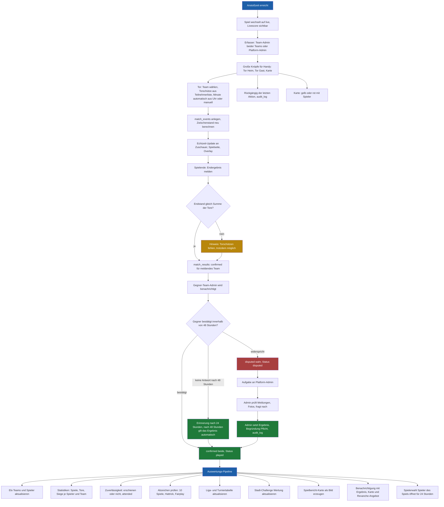

---

## D6. Zahlung und Webhook (Sequenz, Phase 2)

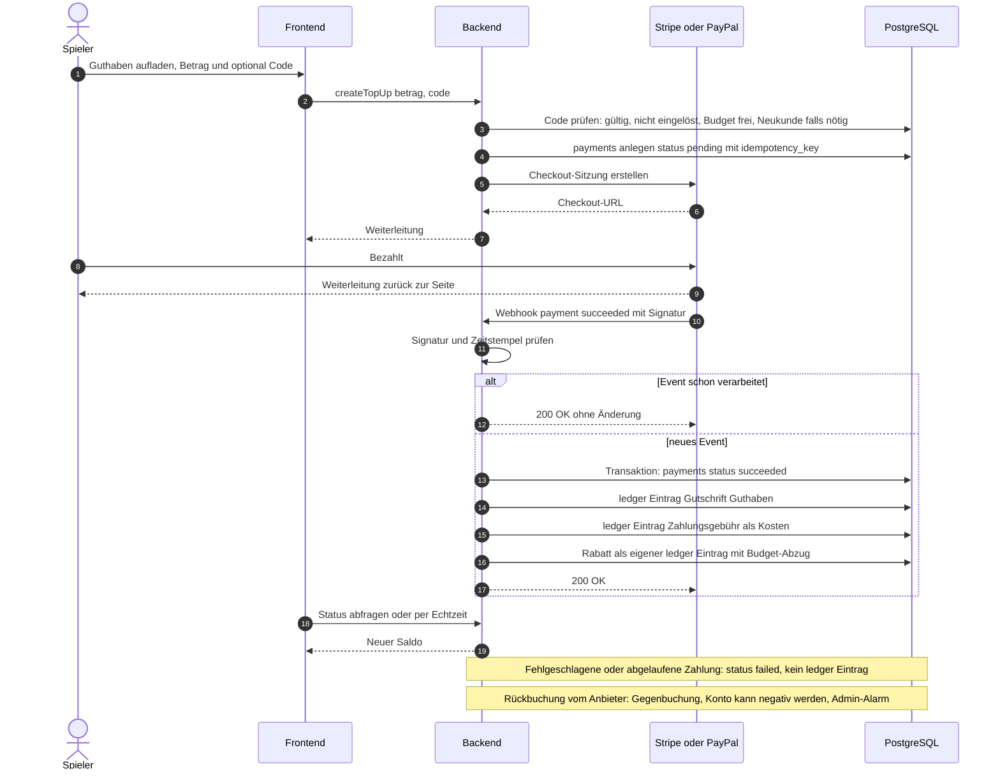

---

## D7. Ledger: Konten und Buchungsarten

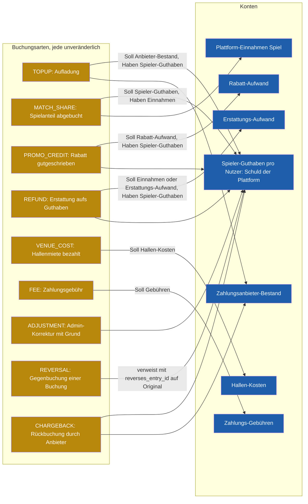

Regeln:
- Jede Buchung hat `idempotency_key`, `reason`, `at`, `actor_id` und bei Spielbezug `match_id`.
- Salden werden aus Buchungen berechnet (mit Zwischensummen nur als Cache).
- Korrekturen sind nur Gegenbuchungen, nie Änderung oder Löschen.
- Offene Guthaben aller Spieler = Schuld der Plattform und erscheint im Monatsabschluss.

---

## D8. Buchungsauftrag (Halle)

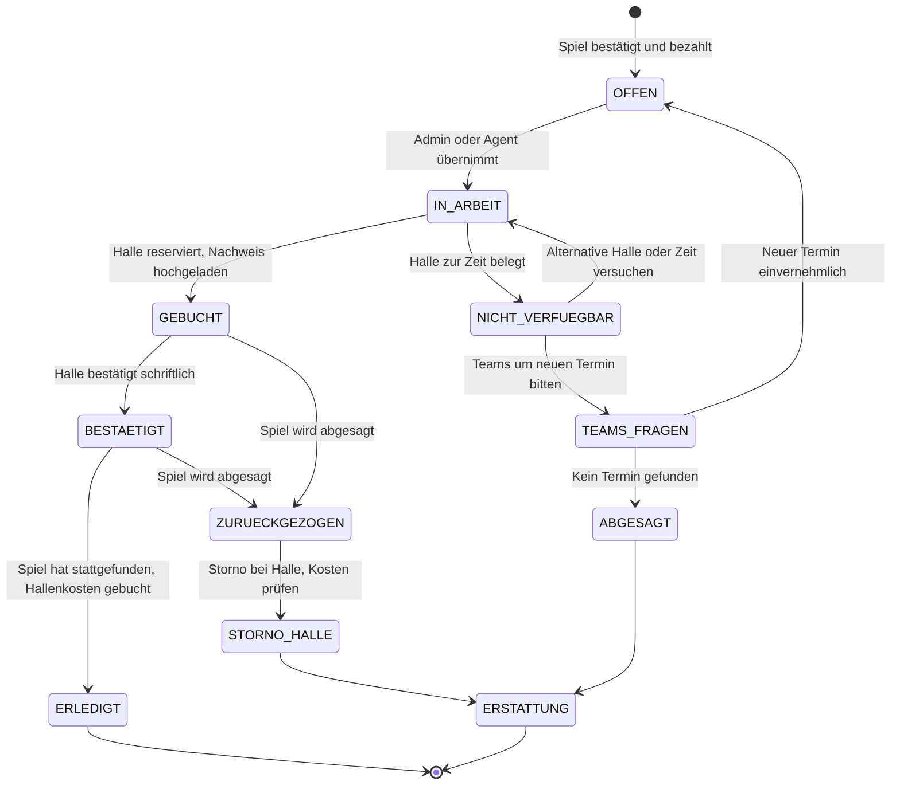

---

## D9. Erstattungs-Entscheidung

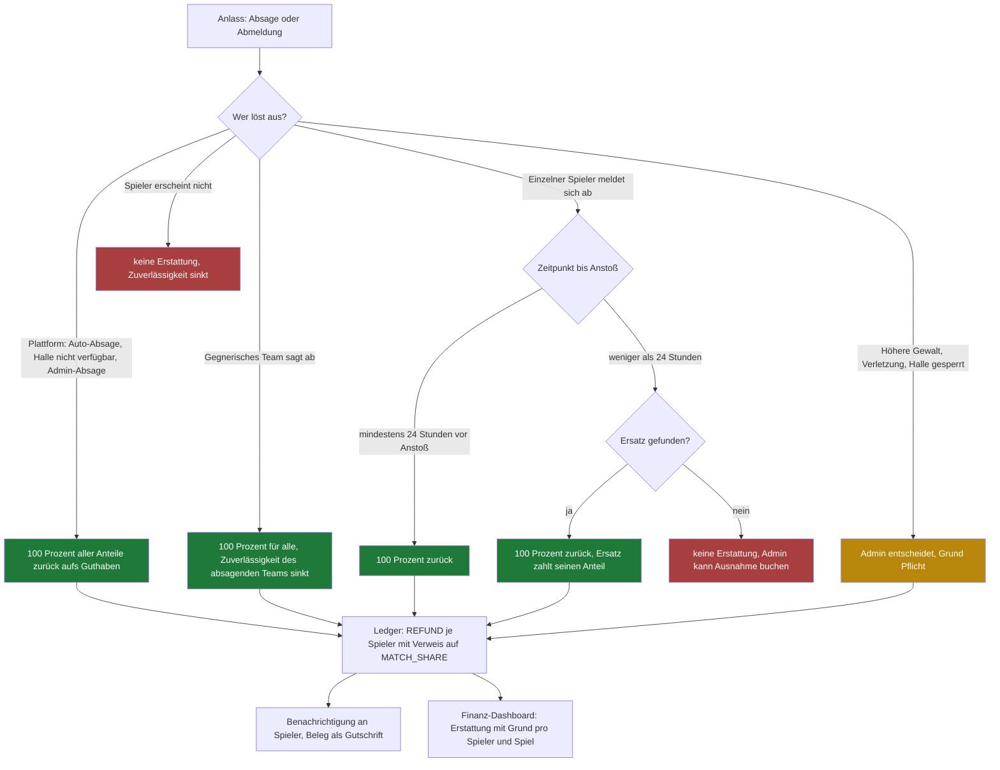

---

## D10. Benachrichtigungen (Auslöser, Empfänger, Kanal)

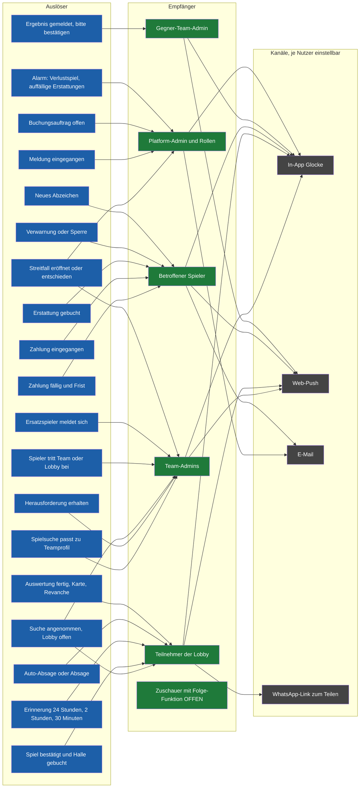

Regeln: Ruhezeiten pro Nutzer, Zusammenfassung statt Einzelnachrichten bei vielen Ereignissen, jede Art einzeln abschaltbar außer Sicherheits- und Zahlungsnachrichten.

---

## D11. Meldungen und Moderation

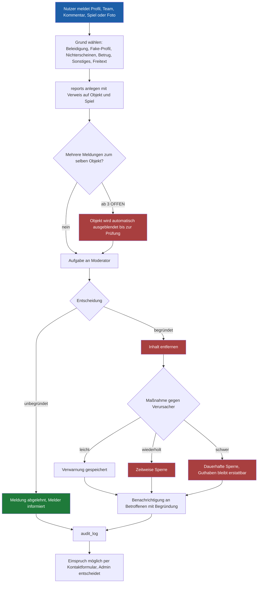

---

## D12. Inhalte der Seiten (was steht wo)

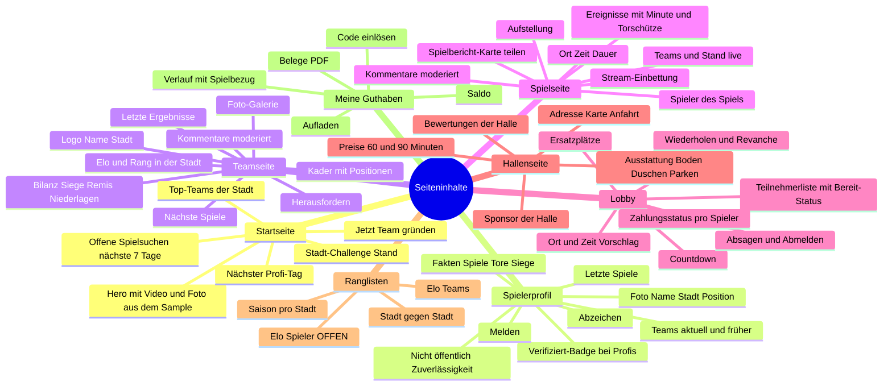

---

## D13. Ligen, Turniere, Stadt-Challenge, Profi-Tag

```mermaid
flowchart TD
  classDef ok fill:#1f7a3a,color:#fff
  classDef step fill:#1d5fa8,color:#fff
  classDef open fill:#b8860b,color:#fff

  subgraph LIGA["Liga und Saison"]
    L1["Admin legt Liga an: NRW, Gelsenkirchen, Essen"]:::step
    L1 --> L2["Saison mit Start und Ende"]
    L2 --> L3["Spiele werden der Saison zugeordnet: automatisch nach Stadt oder manuell"]:::open
    L3 --> L4["Tabelle: Punkte 3 für Sieg 1 für Remis, Tordifferenz, Tore, direkter Vergleich"]
    L4 --> L5["Saisonende: Meister, Archiv, Rangliste setzt zurück"]:::ok
  end

  subgraph CHALLENGE["Stadt-Challenge"]
    C1["Monatliche Paarung zweier Städte"]:::step
    C1 --> C2["Jedes bestätigte Spiel zählt für die Stadt des Teams"]
    C2 --> C3["Wertung: Siege pro Stadt, OFFEN: Normierung nach Teamanzahl"]:::open
    C3 --> C4["Monatsende: Sieger-Stadt, Abzeichen, Social-Karte"]:::ok
  end

  subgraph TURNIER["Turniere gegen Gebühr"]
    T1["Veranstalter legt Turnier an: Datum, Ort, Gebühr, max Teams, Modus"]:::step
    T1 --> T2["Teams melden an und zahlen Gebühr, Warteliste bei voll"]
    T2 --> T3["Anmeldeschluss, Admin prüft"]
    T3 --> T4["Spielplan-Generator: Gruppen und K.o. oder Liga-Modus"]
    T4 --> T5["Spiele laufen wie normale Spiele mit Live-Eingabe"]
    T5 --> T6["Tabelle, Finale, Siegerehrung, Auszahlung abzüglich Gebühr OFFEN"]:::open
  end

  subgraph PROTAG["Profi-Tag"]
    P1["Admin legt Event an mit Profi, Datum, Ort"]:::step
    P1 --> P2["Teams bewerben sich"]
    P2 --> P3["Verlosung: Zufall mit Kriterien Zuverlässigkeit und Stadt"]:::open
    P3 --> P4["Gewinnerteam wird informiert, Lobby mit Profi als Teilnehmer"]
    P4 --> P5["Spiel, Fotos, Spielbericht-Karte mit Profi"]:::ok
  end
```

---

## D14. Service-Schnittstellen (Funktionen und Rechte)

```mermaid
classDiagram
  class AuthService {
    +signInWithGoogle() Session
    +completeOnboarding(profile) User
    +requireUser() User
    +requireRole(role) User
    +banUser(userId, reason) void
  }
  class TeamService {
    +createTeam(name, city, logo) Team
    +updateTeam(teamId, patch) Team
    +createInvite(teamId) Invite
    +revokeInvite(token) void
    +joinWithInvite(token) Member
    +removeMember(teamId, userId) void
    +transferAdmin(teamId, userId) void
    +leaveTeam(teamId) void
    +archiveTeam(teamId) void
    +verifyTeam(teamId) void
    +mergeTeams(fromId, toId) void
  }
  class RequestService {
    +createRequest(teamId, input) Request
    +challengeTeam(teamId, targetTeamId, input) Request
    +listOpen(filter) Request[]
    +acceptRequest(requestId, teamId) Match
    +cancelRequest(requestId) void
    +createRecurring(teamId, input) Request[]
    +expireOld() number
  }
  class LobbyService {
    +joinLobby(matchId) Participant
    +joinAsSubstitute(matchId) Participant
    +assignSubstitute(matchId, userId, teamId) void
    +leaveLobby(matchId) void
    +setReady(matchId) void
    +setVenue(matchId, venue) void
    +setMinPlayers(matchId, n) void
    +cancelMatch(matchId, reason) void
    +evaluateConfirmation(matchId) Status
  }
  class ResultService {
    +addEvent(matchId, event) Event
    +undoLastEvent(matchId) void
    +submitResult(matchId, home, away) Result
    +confirmResult(matchId) Result
    +disputeResult(matchId, reason) Result
    +adminSetResult(matchId, home, away, reason) Result
  }
  class RealtimeService {
    +subscribe(channel) Stream
    +publish(channel, payload) void
  }
  class NotificationService {
    +notify(userIds, type, payload) void
    +setPreferences(prefs) void
    +digest(userId) void
  }
  class LedgerService {
    +post(entry) Entry
    +reverse(entryId, reason) Entry
    +balance(userId) Money
    +statement(userId, range) Entry[]
  }
  class PaymentService {
    +createTopUp(amount, code) Checkout
    +handleWebhook(event, signature) void
    +chargeMatchShare(matchId, userId) Entry
  }
  class RefundService {
    +decide(matchId, userId, trigger) Decision
    +refund(matchId, userId, amount, reason) Entry
    +cancelAndRefundAll(matchId) void
  }
  class PromoService {
    +validate(code, userId) Promo
    +redeem(code, userId) Entry
    +create(rule) Promo
  }
  class BookingService {
    +createJob(matchId) Job
    +assign(jobId, assignee) void
    +markBooked(jobId, proof) void
    +markFailed(jobId, note) void
  }
  class FinanceReportService {
    +perMatch(matchId) Report
    +perPlayer(matchId) Row[]
    +monthly(month) Report
    +liabilities() Money
    +exportCsv(range) File
    +alerts() Alert[]
  }
  class RatingService {
    +updateAfterMatch(matchId) void
    +leaderboard(city, season) Row[]
  }
  class StatsService {
    +playerStats(userId) Stats
    +teamStats(teamId) Stats
    +reliability(userId) Score
  }
  class BadgeService {
    +evaluate(userId) Badge[]
  }
  class ModerationService {
    +report(target, reason) Report
    +decide(reportId, action) void
    +hide(target) void
    +warn(userId, text) void
  }
  class CardService {
    +renderMatchCard(matchId) Image
  }
  class LeagueService {
    +createLeague(input) League
    +createSeason(leagueId, range) Season
    +standings(seasonId) Row[]
  }
  class TournamentService {
    +create(input) Tournament
    +register(tournamentId, teamId) Entry
    +generateSchedule(tournamentId) Match[]
  }
  class AuditService {
    +record(actor, action, entity, before, after) void
    +search(filter) Entry[]
  }

  LobbyService --> NotificationService
  LobbyService --> RealtimeService
  LobbyService --> RefundService
  LobbyService --> BookingService
  RequestService --> LobbyService
  RequestService --> NotificationService
  ResultService --> RealtimeService
  ResultService --> RatingService
  ResultService --> StatsService
  ResultService --> BadgeService
  ResultService --> CardService
  ResultService --> LeagueService
  PaymentService --> LedgerService
  RefundService --> LedgerService
  PromoService --> LedgerService
  FinanceReportService --> LedgerService
  TournamentService --> PaymentService
  TeamService --> AuditService
  LobbyService --> AuditService
  ResultService --> AuditService
  ModerationService --> AuditService
  LedgerService --> AuditService
```

---

## D15. Hintergrundjobs und Zeitsteuerung

```mermaid
flowchart TD
  classDef job fill:#1d5fa8,color:#fff
  classDef eff fill:#1f7a3a,color:#fff

  T1["Jede Minute"]:::job
  T1 --> T1a["Lobbys auf Mindestanzahl und 24-Stunden-Frist prüfen"]:::eff
  T1 --> T1b["Spiele zur Anstoßzeit auf live setzen"]:::eff
  T1 --> T1c["Erinnerungen versenden: 24 h, 2 h, 30 min vor Anstoß"]:::eff

  T2["Alle 5 Minuten"]:::job
  T2 --> T2a["Abgelaufene Spielsuchen auf expired"]:::eff
  T2 --> T2b["Nicht bestätigte Zahlungen abgleichen mit Anbieter"]:::eff
  T2 --> T2c["Ergebnis ohne Antwort nach 24 und 48 Stunden erinnern oder eskalieren"]:::eff

  T3["Stündlich"]:::job
  T3 --> T3a["Wiederkehrende Spiele: nächste Woche vorab anlegen"]:::eff
  T3 --> T3b["Offene Buchungsaufträge älter als 12 Stunden an Admin melden"]:::eff
  T3 --> T3c["Einladungs-Token abgelaufen löschen"]:::eff
  T3 --> T3d["Spieler des Spiels Wahl nach 24 Stunden schließen"]:::eff

  T4["Täglich"]:::job
  T4 --> T4a["Alarme: Verlustspiele, auffällige Erstattungen, Zahlung ohne Buchung"]:::eff
  T4 --> T4b["Ledger-Prüfung: Summen stimmen mit Zahlungsanbieter überein"]:::eff
  T4 --> T4c["Datenbank-Sicherung"]:::eff
  T4 --> T4d["Zuverlässigkeits-Werte neu berechnen"]:::eff

  T5["Wöchentlich und monatlich"]:::job
  T5 --> T5a["Wöchentlich: Rangliste je Stadt"]:::eff
  T5 --> T5b["Monatlich: Monatsabschluss, Stadt-Challenge schließen, Saisonwechsel prüfen"]:::eff
  T5 --> T5c["Monatlich: Guthaben-Schuld Bericht"]:::eff
```

---

## D16. Sicherheit und Integrität

```mermaid
mindmap
  root((Sicherheit))
    Zugang
      Google OAuth only
      Mindestalter 16
      Sperren prüfen bei jeder Anfrage
      Rollen serverseitig prüfen nie nur im Frontend
    Missbrauch
      Rate-Limit für Login Einladung Meldung Erstellung
      Maximale Spielsuchen pro Team
      Einladungs-Token 128 Bit mit Ablauf
      Duplikat-Erkennung Teams
    Daten
      Eingaben mit Zod prüfen
      SQL nur parametrisiert über Drizzle
      Ausgabe escapen
      Uploads Typ und Größe begrenzen
      Bilder neu enkodieren
    Geld
      Beträge als Cent Integer
      Ledger unveränderlich
      Webhooks mit Signatur und Idempotenz
      Admin-Korrekturen nur als Gegenbuchung
      Tägliche Abstimmung mit Anbieter
    Nachvollziehbarkeit
      audit_log für jede Admin-Aktion
      Vorher und Nachher gespeichert
      Ergebnisse zweistufig bestätigt
      Streitfall mit Begründung Pflicht
    Datenschutz
      Datenexport pro Nutzer
      Konto löschen mit Anonymisierung
      Nur Fakten in Profilen
      Zuverlässigkeit nur für Admins sichtbar
      Einwilligungen mit Zeitstempel
    Betrieb
      Secrets nur in Umgebungsvariablen
      Sicherungen getestet
      Fehler in Sentry
      Abhängigkeiten regelmäßig aktualisieren
```

---

## D17. Offene Entscheidungen

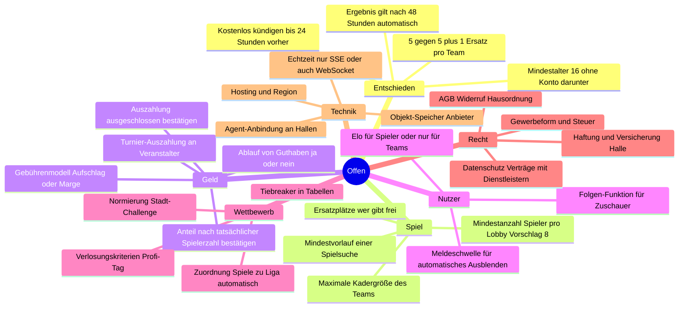
