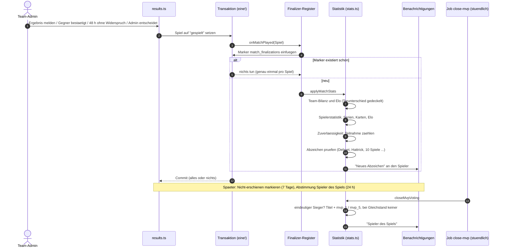
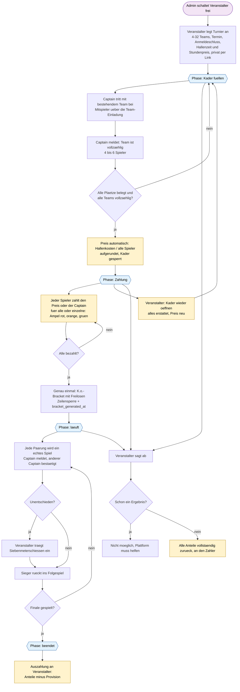
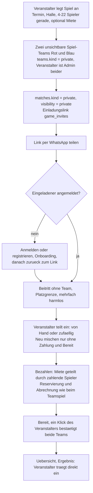
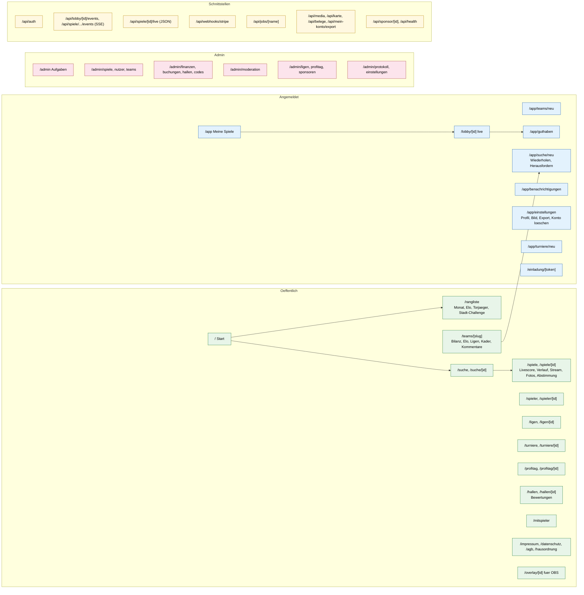
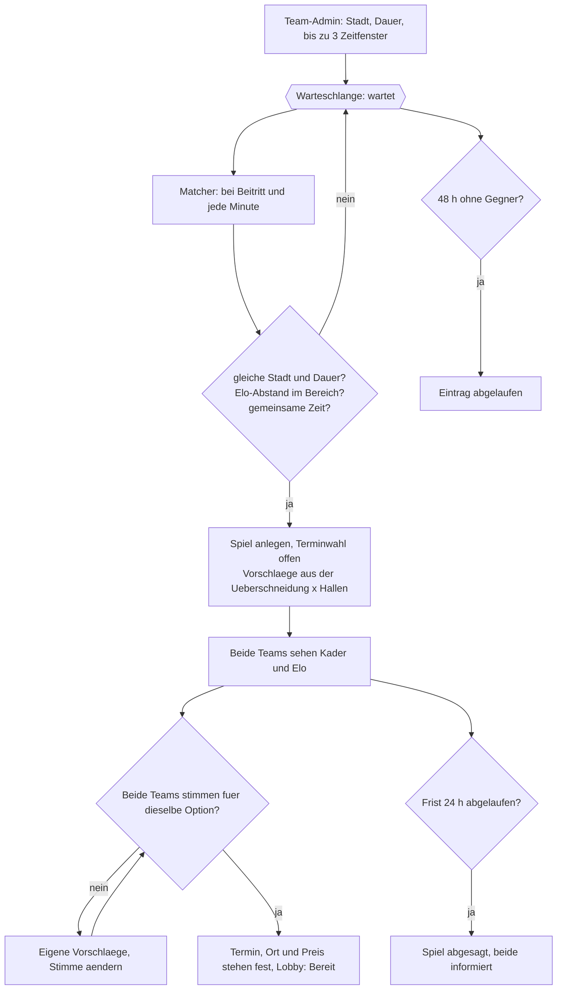
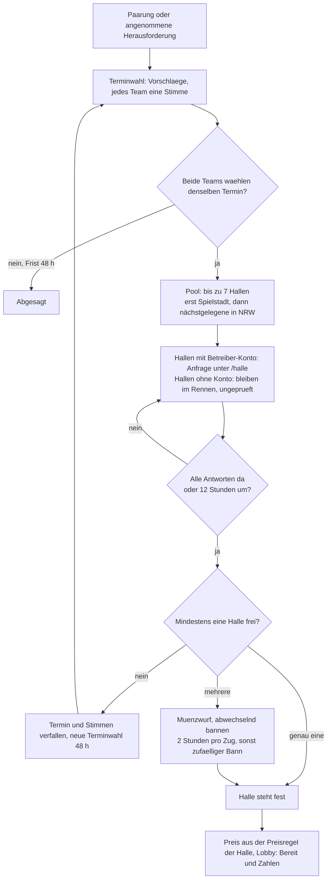

# Architektur: so ist es gebaut

Die ersten beiden Dokumente (`ARCHITEKTUR.md`, `ARCHITEKTUR-DETAIL.md`) beschreiben den Plan. Dieses hier zeigt den umgesetzten Stand. Alle Diagramme sind auch in `architektur.html` (Ebene 3) zu sehen.

## Datenmodell (gebaut)

Alle Tabellen, die es tatsächlich gibt: Spielbetrieb, Geld, Statistik, Inhalte, Wettbewerbe.

```mermaid
erDiagram
  users ||--o{ team_members : "ist Mitglied"
  teams ||--o{ team_members : hat
  teams ||--o{ invites : erzeugt
  teams ||--o{ match_requests : sucht
  match_requests }o--o| teams : "fordert heraus (target_team_id)"
  match_requests ||--o| matches : "wird zu"
  teams ||--o{ matches : "Heim/Gast"
  matches ||--o{ match_participants : Lobby
  users ||--o{ match_participants : nimmt_teil
  matches ||--o{ match_events : "Tore/Karten"
  matches ||--o| match_results : Ergebnis
  matches ||--o| match_finalizations : "genau einmal ausgewertet"
  users ||--o{ notifications : erhaelt
  users ||--o| notification_prefs : stellt_ein
  users ||--o{ push_subscriptions : Geraete

  users ||--o{ ledger_entries : "Guthaben (Soll/Haben)"
  payments ||--o{ ledger_entries : bucht
  matches ||--o{ ledger_entries : Anteil
  tournaments ||--o{ ledger_entries : Startgeld
  users ||--o{ payments : zahlt
  users ||--o{ receipts : bekommt
  promo_codes ||--o{ promo_redemptions : eingeloest
  venues ||--o{ price_rules : Preise
  matches ||--o{ booking_jobs : Buchung
  matches ||--o{ expenses : Ausgaben

  teams ||--o| team_stats : "Elo, Bilanz"
  users ||--o| player_stats : "Tore, Elo, Serien"
  users ||--o{ user_badges : Abzeichen
  users ||--o| user_reliability : "privat"
  matches ||--o{ mvp_votes : "Spieler des Spiels"
  teams ||--o{ rating_history : Elo_Verlauf

  users ||--o{ comments : schreibt
  comments ||--o{ comment_reports : gemeldet
  users ||--o{ user_warnings : verwarnt
  users ||--o{ media : "Bilder"
  users ||--o{ free_player_posts : "Ich suche ein Spiel"

  leagues ||--o{ league_teams : Teilnehmer
  teams ||--o{ league_teams : spielt_in
  pro_events ||--o{ pro_applications : Bewerbungen
  teams ||--o{ pro_applications : bewirbt_sich
  tournaments ||--o{ tournament_teams : Anmeldungen
  tournaments ||--o{ tournament_matches : Spielplan
  sponsors ||--o{ team_sponsors : Trikotpartner
  teams ||--o{ team_sponsors : traegt
  city_challenge_results {
    text month
    text city
    int wins
    int rank
  }
  ledger_entries {
    uuid id
    enum debit_account
    enum credit_account
    int amount_cents
    enum kind
    text idempotency_key "eindeutig"
  }
  tournaments {
    uuid id
    text format "round_robin | knockout | groups_ko"
    int entry_fee_cents
    text status
  }
  matches {
    uuid id
    enum status
    int price_cents
    text stream_url
    uuid mvp_user_id
  }
```

## Auswertung nach dem Spiel (gebaut)

Eine Transaktion, genau einmal pro Spiel: Bilanz, Elo, Statistik, Zuverlässigkeit, Abzeichen; danach die Abstimmung zum Spieler des Spiels.

## Drei Spielarten (gebaut)

Teamspiel, Privatspiel und Turnier sind in der Oberfläche getrennt (`GameModes` auf Startseite und Mein Bereich). Alle drei nutzen dieselbe Team-, Einladungs-, Guthaben- und Ergebnislogik. Es gibt keine zweite Lobby-Logik: Spiele sind immer Zeilen in `matches`, unterschieden durch `matches.kind` (`team`, `private`, `tournament`). Nur `team` zählt für Elo, Statistik und Rangliste (`applyMatchStats` bricht sonst ab).

## Turnier (gebaut)

Privat per Einladungslink, ein Captain pro Team. Phasen: Kader füllen, Zahlung, läuft, beendet. Der Preis pro Spieler wird erst berechnet, wenn alle Teams vollzählig gemeldet haben. Dann gibt es kein Hin- und Herbuchen: Jeder zahlt genau den Endpreis.

## Privatspiel (gebaut)

Eine Person legt ein Spiel für ihre Freundesgruppe an (Standard 10 Spieler). Das Spiel ist nie öffentlich, nur über `/spiel/<token>` erreichbar und zählt nicht für die Rangliste.

## Alle Seiten und Schnittstellen (gebaut)

Öffentlich, angemeldet, Admin und API, wie sie im Code stehen.

## Matchmaking und gemeinsame Terminwahl (gebaut)

Teams stellen sich mit Zeitfenstern in die Warteschlange. Alle 60 Sekunden und bei jedem Beitritt werden passende Teams gepaart. Danach wählen beide Teams Termin und Ort aus Vorschlägen; stimmen beide für dieselbe Option, steht das Spiel.

Elo-Bereich: 100 am Anfang, alle 5 Minuten Wartezeit +50, höchstens 600. Es zählt der größere der beiden Bereiche.

## Termin, Hallen-Anfrage und Hallen-Veto (gebaut)

Reihenfolge: erst einigen sich beide Teams auf Tag und Uhrzeit. Danach werden die Hallen angefragt. Erst wenn alle Antworten da sind, beginnt das Veto unter den freien Hallen.

