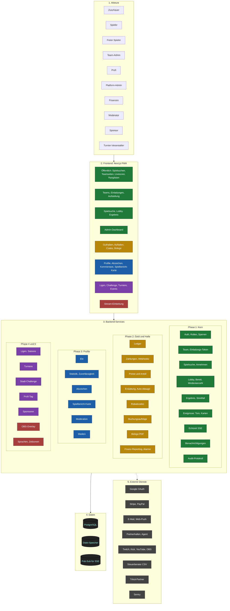
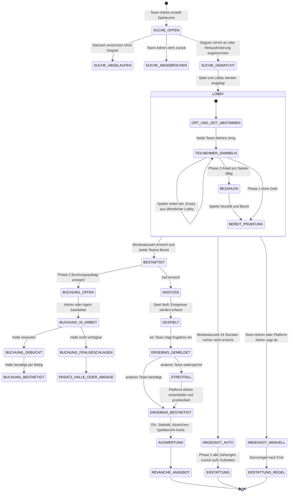
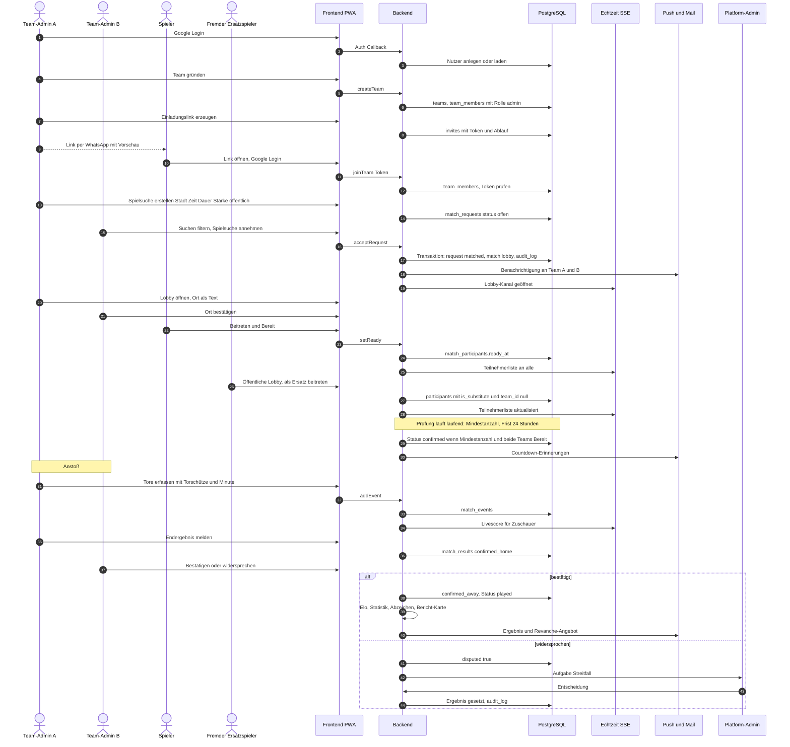
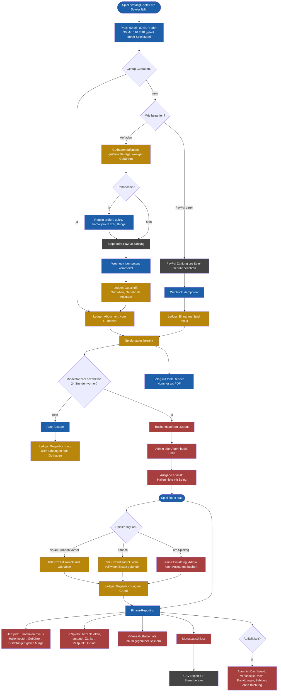
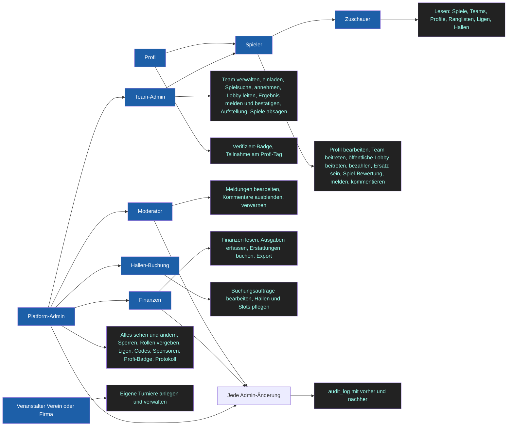
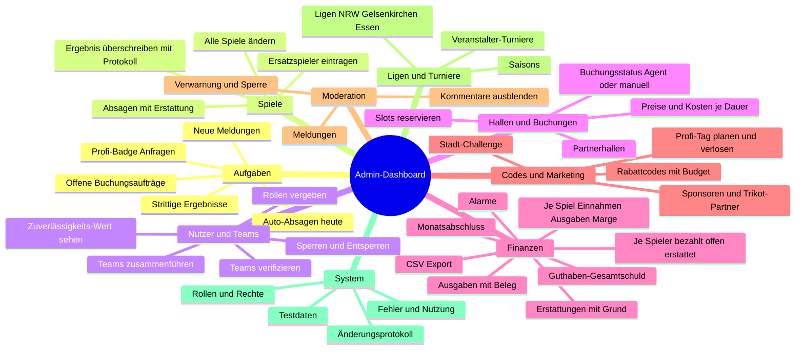
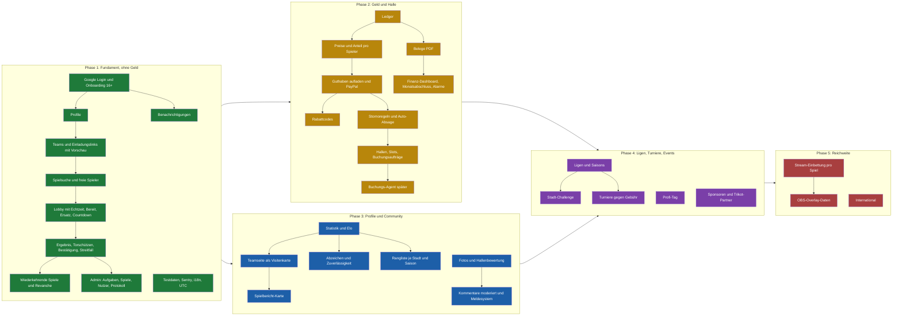
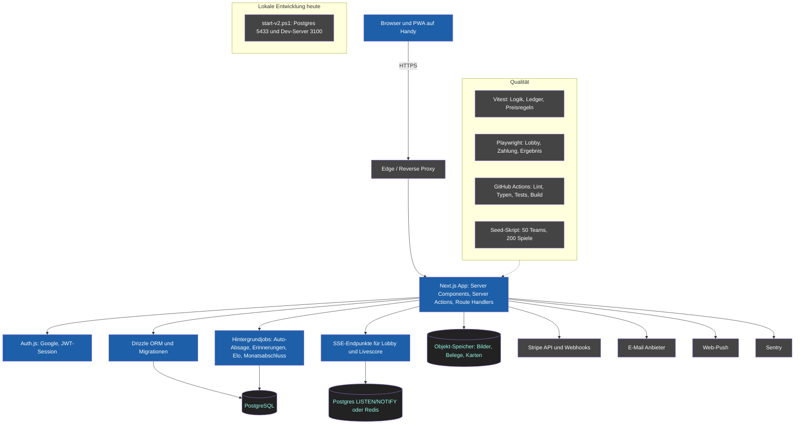

# SoccaV2 – Architektur in Diagrammen

Legende der Phasen in allen Diagrammen:
**P1** Fundament (Auth, Teams, Spielsuche, Lobby, Ergebnis) · **P2** Geld und Halle · **P3** Profile und Community · **P4** Ligen, Turniere, Events · **P5** Reichweite (Streaming, International)

---

## 1. Gesamtübersicht (Akteure, Oberflächen, Dienste, Daten, Externe)

---

## 2. Seitenstruktur (alle Routen nach Rolle)

```mermaid
flowchart TD
  classDef pub fill:#1f7a3a,color:#fff
  classDef usr fill:#1d5fa8,color:#fff
  classDef adm fill:#a83f3f,color:#fff

  ROOT["/ Startseite: Hero, offene Spielsuchen, Top-Teams, Stadt-Challenge, nächster Profi-Tag"]:::pub

  ROOT --> SUCHEN["/suche Spielsuchen filtern nach Stadt, Datum, Stärke, Dauer"]:::pub
  SUCHEN --> SUCHEN_ID["/suche/id Details, Herausfordern, Annehmen"]:::pub

  ROOT --> TEAMS["/teams Teamverzeichnis"]:::pub
  TEAMS --> TEAM["/teams/slug Teamseite: Logo, Bilanz, nächste Spiele, Fotos, Herausfordern"]:::pub
  ROOT --> SPIELER["/spieler Spielerverzeichnis"]:::pub
  SPIELER --> SPIELER_ID["/spieler/id Profil: Fakten, Abzeichen, Historie, Verifiziert-Badge"]:::pub
  ROOT --> SPIELE["/spiele Livescore und Ergebnisse"]:::pub
  SPIELE --> SPIEL["/spiele/id Spielseite: Stand, Ereignisse, Aufstellung, Kommentare, Stream"]:::pub
  SPIEL --> BERICHT["/spiele/id/bericht Spielbericht-Karte teilen"]:::pub
  ROOT --> RANG["/rangliste Elo und Saison pro Stadt"]:::pub
  ROOT --> LIGEN["/ligen Ligen NRW, Gelsenkirchen, Essen"]:::pub
  LIGEN --> LIGA["/ligen/slug Tabelle und Spielplan"]:::pub
  ROOT --> CHALL["/challenge Stadt gegen Stadt"]:::pub
  ROOT --> EVENT["/events Profi-Tag und Sonderevents"]:::pub
  ROOT --> TURNIERE["/turniere Turniere gegen Gebühr"]:::pub
  TURNIERE --> TURNIER["/turniere/id Anmeldung, Spielplan, Tabelle"]:::pub
  ROOT --> HALLEN["/hallen Hallenseiten mit Bewertung"]:::pub
  ROOT --> RECHT["/impressum /datenschutz /agb /hausordnung"]:::pub

  ROOT --> LOGIN["/anmelden Google Login"]:::pub
  LOGIN --> ONB["/willkommen Onboarding: Name, Stadt, Position, Alter 16+"]:::usr

  ONB --> HOME["/app Mein Bereich"]:::usr
  HOME --> PROF_EDIT["/app/profil bearbeiten"]:::usr
  HOME --> EINST["/app/einstellungen Benachrichtigungen, Datenexport, Konto löschen"]:::usr
  HOME --> MEINETEAMS["/app/teams meine Teams"]:::usr
  MEINETEAMS --> TEAM_NEU["/app/teams/neu Team gründen"]:::usr
  MEINETEAMS --> TEAM_VERW["/app/teams/id Mitglieder, Aufstellung, Logo, Einladung"]:::usr
  TEAM_VERW --> INV_LINK["/einladung/token Beitritt über Link mit Vorschau"]:::pub
  HOME --> SUCHE_NEU["/app/suche/neu Spielsuche erstellen"]:::usr
  HOME --> FREI["/app/ich-suche-spiel Freier-Spieler-Wunsch"]:::usr
  HOME --> MEINESPIELE["/app/spiele meine Spiele"]:::usr
  MEINESPIELE --> LOBBY["/app/lobby/id Lobby, Countdown, Bereit, Zahlungsstatus"]:::usr
  LOBBY --> ERG["/app/lobby/id/ergebnis Ergebnis und Torschützen eintragen"]:::usr
  LOBBY --> REVANCHE["Revanche-Button"]:::usr
  MEINESPIELE --> WIEDER["Wiederkehrende Spiele jeden Donnerstag 20 Uhr"]:::usr
  HOME --> WALLET["/app/guthaben Saldo, Aufladen, PayPal, Codes, Verlauf, Belege"]:::usr
  HOME --> MELDEN["Melden Dialog auf Profil, Team, Kommentar"]:::usr

  ROOT --> ADM["/admin"]:::adm
  ADM --> A_TASKS["/admin/aufgaben: offene Buchungen, strittige Ergebnisse, Meldungen"]:::adm
  ADM --> A_SPIELE["/admin/spiele alle Spiele ändern, Ersatz eintragen, absagen"]:::adm
  ADM --> A_USER["/admin/nutzer Sperren, Rollen, Profi-Badge, Zuverlässigkeit"]:::adm
  ADM --> A_TEAMS["/admin/teams verifizieren, zusammenführen"]:::adm
  ADM --> A_HALLEN["/admin/hallen Partnerhallen, Slots, Preise"]:::adm
  ADM --> A_BUCH["/admin/buchungen Buchungsaufträge, Agent-Status"]:::adm
  ADM --> A_FIN["/admin/finanzen"]:::adm
  A_FIN --> A_FIN1["Je Spiel: Einnahmen, Ausgaben, Marge"]:::adm
  A_FIN --> A_FIN2["Je Spieler: bezahlt, offen, erstattet, Grund"]:::adm
  A_FIN --> A_FIN3["Guthaben-Gesamtschuld"]:::adm
  A_FIN --> A_FIN4["Ausgaben erfassen mit Beleg"]:::adm
  A_FIN --> A_FIN5["Monatsabschluss und CSV-Export"]:::adm
  A_FIN --> A_FIN6["Alarme"]:::adm
  ADM --> A_CODES["/admin/codes Rabattcodes, Budget, Gültigkeit"]:::adm
  ADM --> A_MOD["/admin/moderation Meldungen, Kommentare, Verwarnungen"]:::adm
  ADM --> A_LIGEN["/admin/ligen Ligen, Saisons, Challenge, Profi-Tag"]:::adm
  ADM --> A_TURN["/admin/turniere Veranstalter-Turniere"]:::adm
  ADM --> A_SPON["/admin/sponsoren Platzierungen, Trikot-Partner"]:::adm
  ADM --> A_AUDIT["/admin/protokoll Änderungsprotokoll durchsuchen"]:::adm
  ADM --> A_ROLLEN["/admin/rollen Finanzen, Moderation, Hallen-Buchung"]:::adm
```

---

## 3. Lebenszyklus: Spielsuche und Spiel (Zustände)

---

## 4. Ablauf aus Nutzersicht (Sequenz: von der Anmeldung bis zum Ergebnis)

---

## 5. Datenmodell (ER, Phase 1 bis 4)

```mermaid
erDiagram
  USERS ||--o{ TEAM_MEMBERS : "ist Mitglied"
  TEAMS ||--o{ TEAM_MEMBERS : "hat"
  TEAMS ||--o{ INVITES : "erzeugt"
  USERS ||--o{ INVITES : "erstellt"
  TEAMS ||--o{ MATCH_REQUESTS : "sucht"
  MATCH_REQUESTS ||--o| MATCHES : "wird zu"
  TEAMS ||--o{ MATCHES : "Heim"
  TEAMS ||--o{ MATCHES : "Gast"
  MATCHES ||--o{ MATCH_PARTICIPANTS : "Teilnehmer"
  USERS ||--o{ MATCH_PARTICIPANTS : "spielt"
  MATCHES ||--o{ MATCH_EVENTS : "Ereignisse"
  MATCHES ||--o| MATCH_RESULTS : "Ergebnis"
  USERS ||--o{ AUDIT_LOG : "Akteur"
  USERS ||--o{ WALLET_ACCOUNTS : "besitzt"
  WALLET_ACCOUNTS ||--o{ LEDGER_ENTRIES : "Buchungen"
  MATCHES ||--o{ LEDGER_ENTRIES : "bezogen auf"
  USERS ||--o{ PAYMENTS : "zahlt"
  PAYMENTS ||--o{ LEDGER_ENTRIES : "erzeugt"
  PROMO_CODES ||--o{ PROMO_REDEMPTIONS : "eingelöst"
  USERS ||--o{ PROMO_REDEMPTIONS : "löst ein"
  VENUES ||--o{ VENUE_SLOTS : "Zeitfenster"
  VENUES ||--o{ PRICE_RULES : "Preise"
  MATCHES ||--o| BOOKING_JOBS : "Buchungsauftrag"
  VENUES ||--o{ BOOKING_JOBS : "Halle"
  MATCHES ||--o{ EXPENSES : "Ausgaben"
  VENUES ||--o{ VENUE_REVIEWS : "bewertet"
  USERS ||--o{ VENUE_REVIEWS : "schreibt"
  USERS ||--o{ REPORTS : "meldet"
  USERS ||--o{ COMMENTS : "schreibt"
  MATCHES ||--o{ COMMENTS : "unter Spiel"
  TEAMS ||--o{ COMMENTS : "unter Team"
  USERS ||--o{ BADGES_AWARDED : "erhält"
  BADGES ||--o{ BADGES_AWARDED : "Typ"
  USERS ||--o{ RELIABILITY_STATS : "Zuverlässigkeit"
  TEAMS ||--o{ RATINGS : "Elo-Verlauf"
  USERS ||--o{ RATINGS : "Elo-Verlauf"
  LEAGUES ||--o{ SEASONS : "Saisons"
  SEASONS ||--o{ STANDINGS : "Tabelle"
  TEAMS ||--o{ STANDINGS : "Platz"
  SEASONS ||--o{ MATCHES : "gehört zu"
  CITY_CHALLENGES ||--o{ CHALLENGE_SCORES : "Wertung"
  TOURNAMENTS ||--o{ TOURNAMENT_ENTRIES : "Anmeldungen"
  TEAMS ||--o{ TOURNAMENT_ENTRIES : "meldet an"
  TOURNAMENTS ||--o{ MATCHES : "Turnierspiele"
  PRO_EVENTS ||--o{ PRO_EVENT_ENTRIES : "Teilnahme"
  TEAMS ||--o{ PRO_EVENT_ENTRIES : "Verlosung"
  USERS ||--o{ PRO_EVENTS : "Profi"
  SPONSORS ||--o{ SPONSOR_PLACEMENTS : "Platzierung"
  VENUES ||--o{ SPONSOR_PLACEMENTS : "in Halle"
  USERS ||--o{ NOTIFICATION_PREFS : "Einstellungen"
  USERS ||--o{ MEDIA : "lädt hoch"
  MATCHES ||--o{ MEDIA : "Fotos"
  USERS ||--o{ FREE_PLAYER_WISHES : "Spielwunsch"

  USERS {
    uuid id PK
    text google_id
    text email
    text name
    text avatar_url
    text role
    text city
    text position
    bool is_verified_pro
    timestamp banned_at
    date birth_year
    text locale
    timestamp created_at
  }
  TEAMS {
    uuid id PK
    text name
    text slug
    text city
    text logo_url
    int strength
    bool is_verified
    uuid created_by FK
    float lat
    float lng
  }
  TEAM_MEMBERS {
    uuid team_id FK
    uuid user_id FK
    text role
    timestamp joined_at
  }
  INVITES {
    text token PK
    uuid team_id FK
    uuid created_by FK
    timestamp expires_at
  }
  MATCH_REQUESTS {
    uuid id PK
    uuid team_id FK
    text city
    timestamp starts_at
    int duration_min
    int strength
    text visibility
    text status
    text recurrence
    uuid target_team_id FK
    text note
  }
  MATCHES {
    uuid id PK
    uuid request_id FK
    uuid home_team_id FK
    uuid away_team_id FK
    uuid season_id FK
    uuid tournament_id FK
    uuid venue_id FK
    timestamp starts_at
    int duration_min
    text venue_text
    text visibility
    int min_players
    text status
    text stream_url
  }
  MATCH_PARTICIPANTS {
    uuid match_id FK
    uuid user_id FK
    uuid team_id FK
    bool is_substitute
    timestamp ready_at
    bool attended
  }
  MATCH_EVENTS {
    uuid id PK
    uuid match_id FK
    text type
    uuid user_id FK
    uuid team_id FK
    int minute
  }
  MATCH_RESULTS {
    uuid match_id PK
    int home_score
    int away_score
    bool confirmed_home
    bool confirmed_away
    bool disputed
  }
  AUDIT_LOG {
    uuid id PK
    uuid actor_id FK
    text action
    text entity
    text entity_id
    jsonb before
    jsonb after
    timestamp at
  }
  WALLET_ACCOUNTS {
    uuid id PK
    uuid user_id FK
    text currency
  }
  LEDGER_ENTRIES {
    uuid id PK
    uuid account_id FK
    uuid match_id FK
    uuid payment_id FK
    text kind
    int amount_cents
    text currency
    uuid reverses_entry_id FK
    text reason
    text idempotency_key
    timestamp at
  }
  PAYMENTS {
    uuid id PK
    uuid user_id FK
    text provider
    text provider_ref
    int amount_cents
    int fee_cents
    text status
    text idempotency_key
  }
  PROMO_CODES {
    uuid id PK
    text code
    text kind
    int value
    int budget_cents
    int used_cents
    timestamp valid_until
    bool new_users_only
    int max_per_user
  }
  PROMO_REDEMPTIONS {
    uuid code_id FK
    uuid user_id FK
    int amount_cents
    timestamp at
  }
  VENUES {
    uuid id PK
    text name
    text city
    text address
    float lat
    float lng
    text contact
    text surface
    bool has_showers
    bool has_parking
    bool partner
  }
  VENUE_SLOTS {
    uuid id PK
    uuid venue_id FK
    timestamp starts_at
    int duration_min
    text status
  }
  PRICE_RULES {
    uuid id PK
    uuid venue_id FK
    int duration_min
    int price_cents
    int cost_cents
    text valid_from
  }
  BOOKING_JOBS {
    uuid id PK
    uuid match_id FK
    uuid venue_id FK
    text status
    text assignee
    text proof_url
    text note
  }
  EXPENSES {
    uuid id PK
    uuid match_id FK
    text kind
    int amount_cents
    text receipt_url
    timestamp paid_at
  }
  VENUE_REVIEWS {
    uuid id PK
    uuid venue_id FK
    uuid user_id FK
    int rating
    text text
  }
  REPORTS {
    uuid id PK
    uuid reporter_id FK
    text target_type
    text target_id
    text reason
    text status
    uuid handled_by FK
  }
  COMMENTS {
    uuid id PK
    uuid user_id FK
    uuid match_id FK
    uuid team_id FK
    text body
    timestamp hidden_at
  }
  BADGES {
    uuid id PK
    text code
    text name
    text rule
  }
  BADGES_AWARDED {
    uuid badge_id FK
    uuid user_id FK
    timestamp at
  }
  RELIABILITY_STATS {
    uuid user_id FK
    int promised
    int attended
  }
  RATINGS {
    uuid id PK
    uuid team_id FK
    uuid user_id FK
    uuid match_id FK
    int elo
  }
  LEAGUES {
    uuid id PK
    text name
    text region
  }
  SEASONS {
    uuid id PK
    uuid league_id FK
    date starts_on
    date ends_on
  }
  STANDINGS {
    uuid season_id FK
    uuid team_id FK
    int played
    int wins
    int draws
    int losses
    int goals_for
    int goals_against
    int points
  }
  CITY_CHALLENGES {
    uuid id PK
    text month
    text city_a
    text city_b
  }
  CHALLENGE_SCORES {
    uuid challenge_id FK
    text city
    int wins
  }
  TOURNAMENTS {
    uuid id PK
    uuid organizer_id FK
    text name
    int fee_cents
    int max_teams
    text mode
    text status
  }
  TOURNAMENT_ENTRIES {
    uuid tournament_id FK
    uuid team_id FK
    text payment_status
    text status
  }
  PRO_EVENTS {
    uuid id PK
    uuid pro_user_id FK
    timestamp starts_at
    text status
  }
  PRO_EVENT_ENTRIES {
    uuid event_id FK
    uuid team_id FK
    bool drawn
  }
  SPONSORS {
    uuid id PK
    text name
    text logo_url
  }
  SPONSOR_PLACEMENTS {
    uuid sponsor_id FK
    uuid venue_id FK
    text city
    text position
    timestamp valid_until
  }
  NOTIFICATION_PREFS {
    uuid user_id FK
    bool push
    bool email
    text quiet_hours
  }
  MEDIA {
    uuid id PK
    uuid user_id FK
    uuid match_id FK
    text url
    text kind
  }
  FREE_PLAYER_WISHES {
    uuid id PK
    uuid user_id FK
    text city
    timestamp wish_date
    text status
  }
```

---

## 6. Geldfluss (Phase 2)

---

## 7. Rollen und Rechte

---

## 8. Admin-Dashboard im Überblick

---

## 9. Phasen und Abhängigkeiten

---

## 10. Technischer Aufbau und Betrieb

